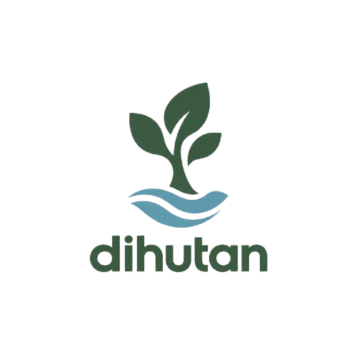

<div align="center">

  

  # 🌿 DiHutan — Modern Forest Technology
  ### **Platform Cerdas Monitoring & Pencegahan Kebakaran Hutan dan Lahan (KARHUTLA) Berbasis IoT & AI**

  [](https://nextjs.org/)
  [](https://react.dev/)
  [](https://www.typescriptlang.org/)
  [](https://supabase.com/)
  [](https://espressif.com/)
  [](https://drive.google.com/file/d/1OvJh5XtWD4I64kgkJLK69zpy28fiMaIP/view)

  <p align="center">
    <strong>Menjaga ekosistem hutan Kalimantan Barat bebas dari karhutla melalui pemantauan telemetri real-time, kecerdasan buatan, dan otomasi pembasahan gambut.</strong>
  </p>

  <p align="center">
    <a href="#-fitur-utama">Fitur Utama</a> •
    <a href="#-arsitektur--spesifikasi-iot">Arsitektur IoT</a> •
    <a href="#-desain-antarmuka--modern-forest-technology">Desain UI/UX</a> •
    <a href="#-panduan-instalasi">Instalasi</a> •
    <a href="#-unduh-aplikasi-android">Download APK</a> •
    <a href="#-struktur-direktori">Struktur Proyek</a>
  </p>

</div>

---

## 📖 Tentang DiHutan

**DiHutan** adalah platform teknologi pemantauan lingkungan terpadu yang dirancang khusus untuk melindungi hutan tropis dan kawasan lahan gambut rawan karhutla, khususnya di wilayah **Daerah Aliran Sungai (DAS) Kapuas dan Kubu Raya, Kalimantan Barat**. 

Platform ini menggabungkan:
1. **IoT Telemetry**: Pemantauan parameter fisik (suhu, kelembapan udara, kelembapan tanah, dan gas/asap) menggunakan mikroprosesor ESP32 dan modul sensor lapangan.
2. **Peatland Water Table (TMA) Simulator**: Estimasi tingkat risiko kebakaran berdasarkan tinggi muka air gambut secara interaktif.
3. **AI Forest Guardian**: Ringkasan cerdas analisis data lingkungan untuk mendeteksi anomali lebih awal.
4. **AutoSpray Automation**: Konsep kendali otomasi pompa pembasahan gambut dan katup solenoid untuk intervensi titik rawan kekeringan.
5. **Perpustakaan Rimba (Ensiklopedia Konservasi)**: Media edukasi publik mengenai flora, fauna endemik (seperti Orangutan Kalimantan), ekosistem gambut, dan hidrologi sungai Kapuas.

---

## 🌟 Fitur Utama

| Fitur | Deskripsi |
| :--- | :--- |
| **🌲 Edisi Renaisans Hutan (Landing Page)** | Halaman depan interaktif dengan visual kanopi hutan Kalimantan, efek paralaks, *3D Interactive Botanical Book*, dan simulasi visual tinggi muka air gambut. |
| **📡 Dashboard Kendali & Telemetri** | Pusat pemantauan komprehensif metrik lingkungan (Suhu, Kelembapan, Gas Karhutla, Kelembapan Tanah Gambut) dengan kartu status *Normal*, *Waspada*, dan *Bahaya*. |
| **🗺️ Monitoring Spasial (Peta Lapangan)** | Integrasi peta GIS interaktif yang memetakan **3 Pos Pantau Utama** di Kalimantan Barat beserta pembacaan telemetri aktif di tiap titik pos. |
| **🤖 AI Forest Guardian** | Asisten kecerdasan buatan untuk mengolah sinyal telemetri menjadi ringkasan status risiko dan saran mitigasi operasional bagi petugas jaga. |
| **💦 AutoSpray & Otomasi Pompa** | Pemantauan kendali solenoid valve dan pompa mini 5V/12V untuk pembasahan otomatis ketika level air gambut memasuki zona kritis. |
| **📦 Katalog Perangkat IoT** | Direktori perangkat keras pemantauan yang mencakup foto asli produk, spesifikasi teknis, fungsi lapangan, serta status konektivitas perangkat (*Online*, *Standby*, *Offline*). |
| **📚 Ensiklopedia Penjaga Rimba** | Perpustakaan botani digital bergaya *Editorial Natural* dengan fitur *Open Book*, pencarian kategori flora/fauna, sistem bookmark, dan informasi konservasi. |
| **🔐 Role-Based Access Control (RBAC)** | Sistem keamanan terintegrasi Supabase Auth dengan pemisahan hak akses: **Public/User** (eksplorasi & edukasi) dan **Petugas / Reaksi Cepat** (monitoring & kendali). |

---

## 🛠️ Arsitektur & Spesifikasi IoT

DiHutan memanfaatkan arsitektur perangkat keras lapangan yang andal dan hemat daya:

<div align="center">
  
  &nbsp;&nbsp;&nbsp;&nbsp;
  
  &nbsp;&nbsp;&nbsp;&nbsp;
  
</div>

- **Mikrokontroler Utama**: ESP32 Development Board (Wi-Fi + BLE dual-core).
- **Expansion Board**: ESP32 Expansion Shield untuk distribusi daya dan perlindungan tegangan.
- **Sensor Suhu & Kelembapan Udara**: DHT11 / DHT22 Digital Sensor.
- **Sensor Gas & Deteksi Asap**: MQ Series Gas Sensor (mendeteksi gas CO/karbon monoksida dan asap pekat awal karhutla).
- **Sensor Kelembapan Tanah Gambut**: Capacitive / Resistive Soil Moisture Probe.
- **Aktuator & Otomasi**:
  - 1-Channel / 4-Channel 5V Relay Module dengan optocoupler isolation.
  - 12V DC Solenoid Valve untuk buka-tutup aliran pipa air gambut.
  - Mini Submersible Water Pump untuk distribusi semprotan air pembasahan.

---

## 🎨 Desain Antarmuka — Modern Forest Technology

Aplikasi menggunakan identitas desain **Modern Forest Technology** yang menggabungkan estetika alam hutan hujan Kalimantan dengan nuansa teknologi mutakhir:

### 🎨 Sistem Warna (Global Color Tokens)

| Peran Token | Nilai Hex | Tampilan | Penggunaan Utama |
| :--- | :--- | :---: | :--- |
| **Primary** | `#173F2B` |  | Deep Forest Green — Tombol utama, header kontras tinggi |
| **Secondary** | `#285C40` |  | Forest Green — Sub-header, elemen interaktif |
| **Accent** | `#8BAF70` |  | Moss Green — Highlight, badge aktif, aksen navigasi |
| **Background** | `#F5F7F2` |  | Soft Natural White — Latar belakang dashboard & halaman utama |
| **Surface/Card** | `#FFFFFF` |  | Pure White — Card metrik, kontainer form, modal |
| **Primary Text** | `#17251D` |  | Dark Forest Text — Keterbacaan tinggi untuk judul & teks penting |
| **Secondary Text** | `#647268` |  | Muted Green Gray — Subteks, satuan sensor, metadata |
| **Border** | `#DFE6DC` |  | Subtle Border — Garis pemisah halus antar komponen |
| **Success** | `#27834A` |  | Kondisi lingkungan aman / normal |
| **Warning** | `#D99A2B` |  | Kondisi waspada / muka air mulai surut |
| **Danger** | `#C7473D` |  | Bahaya karhutla tinggi / asap terdeteksi |

---

## 💻 Tech Stack

- **Framework**: [Next.js 15 (App Router)](https://nextjs.org/)
- **Library UI**: [React 19](https://react.dev/)
- **Bahasa**: [TypeScript](https://www.typescriptlang.org/)
- **Styling**: Vanilla Modern CSS + CSS Modules + [Tailwind CSS v4](https://tailwindcss.com/)
- **Database & Auth**: [Supabase](https://supabase.com/) (PostgreSQL dengan Row Level Security)
- **Icons**: [Lucide React](https://lucide.dev/)
- **Pemetaan**: [MapLibre GL](https://maplibre.org/) & OpenStreetMap
- **Deploy**: Vercel Ready

---

## 🚀 Panduan Instalasi & Menjalankan Lokal

### 1. Prasyarat
- [Node.js](https://nodejs.org/) versi 20.x atau lebih baru
- `npm` atau `pnpm`
- Akun [Supabase](https://supabase.com/) aktif

### 2. Kloning Repositori
```bash
git clone https://github.com/naylasufiatuz/KARHUTLA-DiHutan.git
cd KARHUTLA-DiHutan/dihutan-web
```

### 3. Instalasi Dependensi
```bash
npm install
```

### 4. Konfigurasi Lingkungan (`.env.local`)
Salin file `.env.example` menjadi `.env.local`:
```bash
cp .env.example .env.local
```

Isi kredensial proyek Supabase Anda:
```env
NEXT_PUBLIC_SUPABASE_URL=https://your-project.supabase.co
NEXT_PUBLIC_SUPABASE_ANON_KEY=your-anon-key
```

### 5. Jalankan Server Pengembangan
```bash
npm run dev
```
Buka browser dan akses [http://localhost:3000](http://localhost:3000).

---

## 📱 Unduh Aplikasi Android

Bagi tim patroli lapangan dan pengguna perangkat bergerak, aplikasi Android **DiHutan Mobile** dapat diunduh langsung:

<div align="center">
  <a href="https://drive.google.com/file/d/1OvJh5XtWD4I64kgkJLK69zpy28fiMaIP/view" target="_blank">
    
  </a>
  <p><em>Klik tombol di atas untuk mengunduh berkas APK versi terbaru langsung dari Google Drive.</em></p>
</div>

---

## 📁 Struktur Direktori

```plaintext
KARHUTLA-DiHutan/
├── README.md                      # Dokumentasi utama repositori
├── assets/                        # Dokumentasi visual & media pendukung
└── dihutan-web/                   # Aplikasi Web Next.js 15
    ├── app/                       # App Router Pages & Styles
    │   ├── globals.css            # Token desain global Modern Forest Technology
    │   ├── landing.css            # Stylesheet Landing Page Edisi Renaisans
    │   ├── dashboard.css          # Stylesheet Dashboard & Overview Kendali
    │   ├── technology.css         # Stylesheet Halaman Perangkat IoT
    │   ├── book.css               # Stylesheet 3D Interactive Book
    │   ├── encyclopedia.css       # Stylesheet Ensiklopedia Hutan
    │   ├── register.css           # Stylesheet Autentikasi
    │   ├── layout.tsx             # Root Layout
    │   ├── page.tsx               # Entrypoint Beranda (LandingView)
    │   ├── login/                 # Halaman Login
    │   ├── register/              # Halaman Registrasi
    │   ├── overview/              # Ringkasan Eksekutif
    │   ├── monitoring/            # Peta GIS & Telemetri Real-time
    │   ├── perangkat/             # Katalog Perangkat & Modal Spesifikasi
    │   ├── edukasi/               # Ensiklopedia Penjaga Rimba
    │   └── pengaturan/            # Profil, Keamanan & Diagnostik Sistem
    ├── components/                # Komponen UI Reusable
    │   ├── LandingView.tsx        # View Landing Page Interaktif
    │   ├── DashboardShell.tsx     # Shell Navigasi & Sidebar Dashboard
    │   └── ...                    # Modul pendukung lainnya
    ├── lib/                       # Supabase Client & Helper Utilities
    ├── public/                    # Aset statis, foto perangkat keras, & gambar hero
    ├── alur-web.md                # Dokumentasi arsitektur fungsional
    ├── design.md                  # Panduan Design System
    ├── user-flow.md               # Alur interaksi pengguna & RBAC
    ├── package.json               # Konfigurasi dependensi
    └── next.config.ts             # Konfigurasi Next.js
```

---

## 👥 Kontribusi & Lisensi

Proyek ini dikembangkan sebagai inisiatif pelestarian lingkungan dan mitigasi bencana kebakaran hutan di Kalimantan.

- **Organisasi**: Tim Pengembang DiHutan — KARHUTLA Kalimantan Barat
- **Repositori**: [GitHub naylasufiatuz/KARHUTLA-DiHutan](https://github.com/naylasufiatuz/KARHUTLA-DiHutan)
- **Lisensi**: Hak Cipta & Hak Guna dilindungi untuk inisiatif konservasi lingkungan.

<div align="center">
  <p>🌱 <em>"Hutan yang lestari dan gambut yang basah adalah nafas bagi kehidupan kita bersama."</em></p>
</div>

