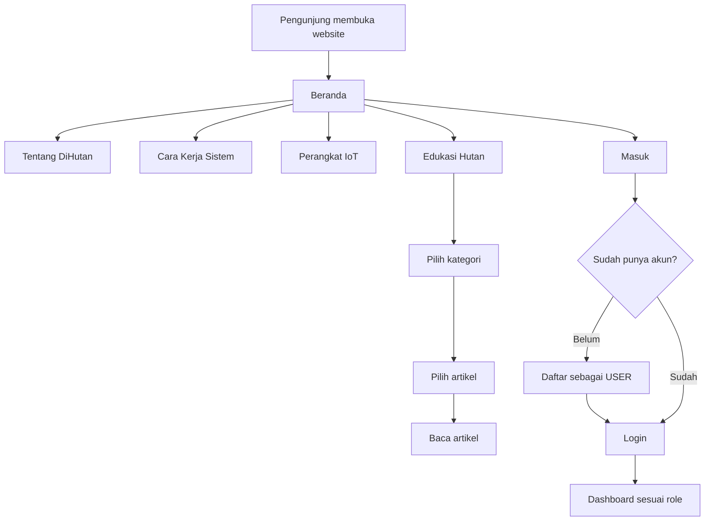
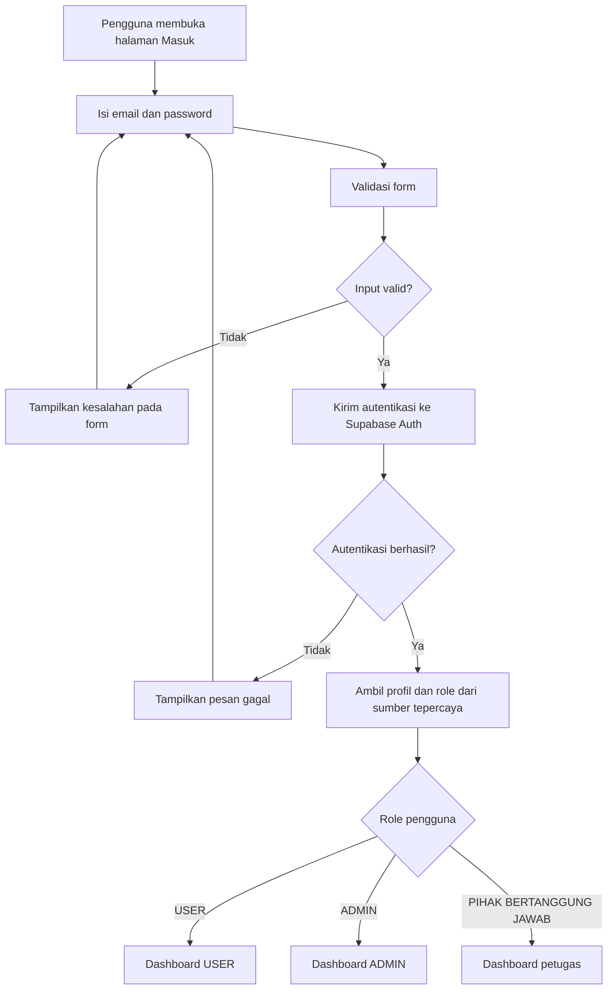
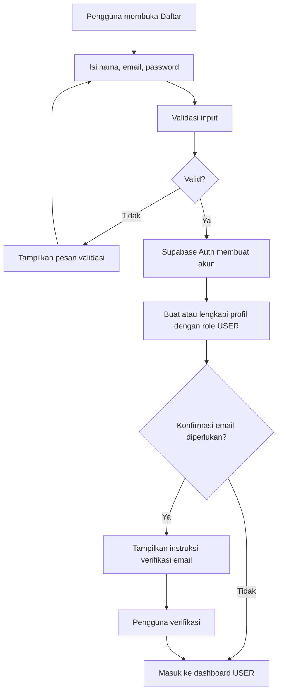
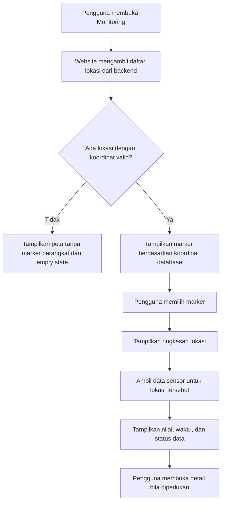
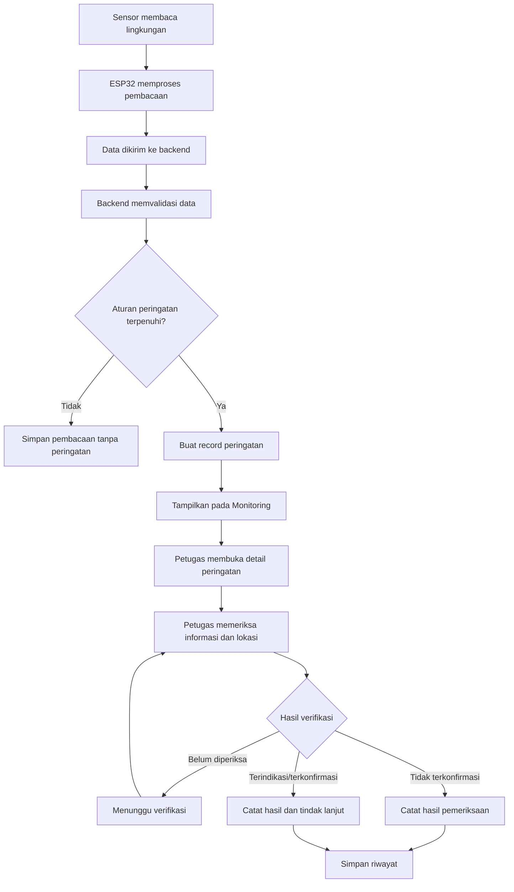
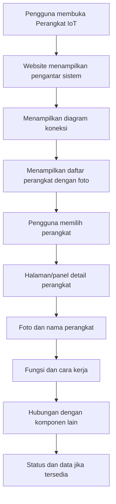
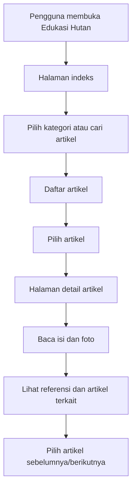
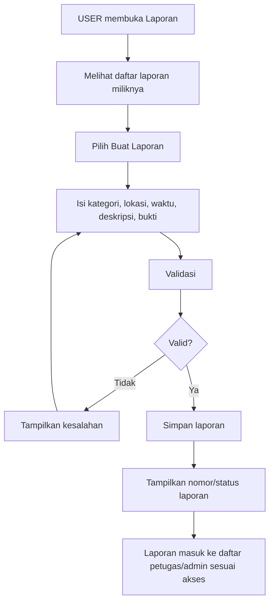
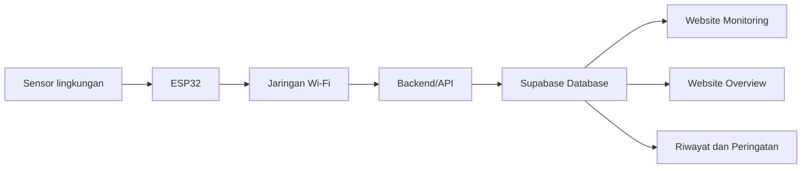

ALUR WEB --- DiHutan
Nama proyek: DiHutan
Jenis produk: Website informasi, edukasi, dan pemantauan lingkungan
berbasis IoT
Wilayah fokus: Hutan Kalimantan, khususnya kawasan Sungai Kapuas,
Kalimantan Barat
Dokumen: alur-web.md
Tujuan: Menjadi panduan implementasi end-to-end bagi AI coding
agent/developer agar memahami bagaimana website DiHutan harus bekerja,
halaman apa saja yang dibuat, dari mana data berasal, bagaimana pengguna
berpindah halaman, dan apa yang terjadi pada setiap interaksi.
Dokumen ini menjelaskan perilaku website dan alur sistem. Detail
visual mengikuti design.md, sedangkan tujuan pengguna dan struktur
pengalaman mengikuti user-flow.md. Ketiganya harus dibaca bersama
sebelum coding.

1. Gambaran Produk
DiHutan adalah website yang memperkenalkan dan menjelaskan sistem
pemantauan lingkungan hutan, perangkat IoT yang digunakan, informasi
kondisi lingkungan, edukasi ekosistem Kalimantan, serta pelaporan dan
tindak lanjut.

Website tidak boleh hanya menjadi dashboard angka sensor. Pengguna harus
bisa memahami keseluruhan cerita sistem:
1. Masalah lingkungan dan alasan DiHutan dibuat.
2. Apa fungsi DiHutan dan siapa yang menggunakannya.
3. Bagaimana sensor membaca kondisi lingkungan.
4. Bagaimana ESP32 mengirim data ke backend.
5. Bagaimana data ditampilkan pada halaman Monitoring.
6. Bagaimana sistem membuat peringatan berdasarkan aturan yang
   tersedia.
7. Bagaimana petugas memeriksa dan mencatat tindak lanjut.
8. Apa fungsi setiap perangkat IoT.
9. Bagaimana pengguna mempelajari flora, fauna, tanah gambut, Sungai
   Kapuas, dan ekosistem Kalimantan.
Prinsip kejujuran sistem: website hanya boleh menampilkan fitur,
status, data, dan kemampuan yang benar-benar tersedia. Jika masih berupa
konsep, tampilkan sebagai rencana atau belum tersedia. Jangan membuat
data, titik lokasi, notifikasi, prediksi AI, atau kontrol perangkat
palsu.
2. Hubungan Dokumen
Sebelum mengembangkan website, AI coding agent wajib membaca:
  Dokumen                             Fungsi
  user-flow.md                      Menjelaskan kebutuhan pengguna,
role, dan perjalanan pengguna.

  design.md                         Menjelaskan visual, warna,
tipografi, layout, komponen, dan
aturan desain.
alur-web.md                       Menjelaskan urutan halaman,
navigasi, interaksi, logika, data,
dan perilaku website.
Jangan membuat alur baru yang bertentangan dengan dokumen tersebut tanpa
menjelaskan konflik dan meminta keputusan.
3. Role dan Hak Akses
Website memiliki tiga role utama:
3.1 USER
Pengguna umum yang sudah memiliki akun.

Dapat: - Melihat Overview. - Melihat Monitoring sesuai hak akses yang
ditentukan. - Melihat perangkat IoT dan penjelasannya. - Membaca artikel
Edukasi Hutan. - Membuat laporan jika fitur pelaporan diaktifkan. -
Melihat riwayat laporan miliknya. - Mengelola profil dan pengaturan
akun.

Tidak dapat: - Mengelola role pengguna. - Mengubah konfigurasi sistem. -
Mengelola seluruh konten. - Mengubah lokasi atau data perangkat tanpa
izin.
3.2 ADMIN
Pengelola website dan data.

Dapat sesuai kebijakan aplikasi: - Mengelola akun dan role. - Mengelola
artikel, kategori, gambar, dan status publikasi. - Melihat serta
mengelola laporan. - Mengelola data perangkat dan lokasi. - Mengelola
konfigurasi ambang batas/peringatan jika fitur tersedia. - Melihat
aktivitas administrasi.
3.3 PIHAK BERTANGGUNG JAWAB
Petugas yang memantau lokasi atau menangani laporan/peringatan.

Dapat sesuai penugasan: - Melihat lokasi dan perangkat yang menjadi
tanggung jawabnya. - Memantau data sensor. - Memeriksa peringatan. -
Memverifikasi indikasi di lapangan. - Memperbarui status tindak
lanjut. - Menambahkan catatan pemeriksaan. - Mengelola titik pemantauan
jika diberi izin.
3.4 Aturan pendaftaran dan keamanan
- Pendaftaran publik hanya menghasilkan role USER.
- Form pendaftaran tidak boleh menyediakan pilihan ADMIN atau PIHAK
  BERTANGGUNG JAWAB.
- Akun dengan role khusus dibuat/ditetapkan melalui proses aman oleh
  admin/developer.
- Role tidak boleh dipercaya dari nilai yang dikirim browser.
- Semua operasi sensitif harus diperiksa di server dan dilindungi
  Supabase Row Level Security (RLS).
- Menyembunyikan tombol/menu saja bukan mekanisme keamanan.
4. Peta Situs dan Route
Gunakan struktur route yang sesuai dengan framework dan repository yang
sudah ada. Jika menggunakan Next.js App Router, struktur konseptual
berikut dapat dijadikan acuan.
4.1 Halaman publik
  Route konseptual        Halaman                 Tujuan
  /                     Beranda                 Memperkenalkan DiHutan
dan mengarahkan
pengunjung.

  /tentang              Tentang DiHutan         Menjelaskan latar
belakang, tujuan, dan
ruang lingkup.

  /cara-kerja           Cara Kerja              Menjelaskan alur sensor
sampai tindak lanjut.

  /perangkat            Perangkat IoT           Memperkenalkan
perangkat dan
fungsinya.

  /edukasi              Indeks Edukasi          Menampilkan kategori
dan artikel.

  /edukasi/[slug]       Detail Artikel          Menampilkan isi
artikel.

  /masuk                Login                   Autentikasi pengguna.

  /daftar               Registrasi              Membuat akun USER.
/lupa-password        Pemulihan Password      Memulai pemulihan akun
jika dikonfigurasi.
4.2 Halaman setelah login
  Route konseptual              Halaman                 Tujuan
  /dashboard                  Overview                Ringkasan dan
penjelasan sistem.

  /dashboard/monitoring       Monitoring              Peta, data sensor,
lokasi, dan peringatan.

  /dashboard/perangkat        Perangkat IoT           Detail komponen dan
status yang dapat
diverifikasi.

  /dashboard/edukasi          Edukasi Hutan           Daftar kategori dan
artikel.

  /dashboard/edukasi/[slug]   Detail Artikel          Membaca artikel.

  /dashboard/laporan          Laporan                 Daftar, detail, dan
pembuatan laporan
sesuai role.
/dashboard/pengaturan       Pengaturan              Profil dan preferensi
akun.
Route administrasi tambahan boleh dibuat bila dibutuhkan, misalnya untuk
pengelolaan artikel atau pengguna. Jangan menambah menu navigasi utama
yang bertentangan dengan user-flow.md.

Catatan: nama route di atas bersifat rancangan. Periksa route yang
sudah ada dan pertahankan struktur proyek bila sudah berjalan. Jangan
menggandakan halaman yang fungsinya sama.
5. Alur Utama Pengunjung Publik

5.1 Perilaku Beranda
Saat pengunjung membuka /:
1. Website menampilkan navbar publik.
2. Hero menjelaskan DiHutan dengan kalimat yang mudah dipahami.
3. Pengunjung melihat konteks masalah kebakaran hutan dan pentingnya
   pemantauan.
4. Website menjelaskan solusi DiHutan.
5. Website menampilkan diagram cara kerja secara ringkas.
6. Website memperkenalkan perangkat IoT dengan foto asli yang tersedia.
7. Website menjelaskan wilayah fokus Sungai Kapuas.
8. Website menampilkan artikel edukasi pilihan.
9. Pengunjung dapat menuju halaman penjelasan, edukasi, atau login.
Interaksi: - Tombol "Pelajari Cara Kerja" membuka /cara-kerja. -
Tombol "Kenali Perangkat" membuka /perangkat. - Tombol "Baca Edukasi"
membuka /edukasi. - Tombol "Masuk" membuka /masuk.

Jangan membuat tombol yang terlihat aktif tetapi tidak memiliki tujuan.
5.2 Perilaku Tentang DiHutan
Halaman menjelaskan: - Latar belakang. - Tujuan. - Masalah yang ingin
dibantu. - Pengguna sasaran. - Ruang lingkup. - Batasan sistem.

Pengunjung dapat melanjutkan ke Cara Kerja atau Perangkat IoT.
5.3 Perilaku Cara Kerja
Tampilkan tahapan proses secara berurutan:
1. Sensor membaca parameter lingkungan.
2. ESP32 mengambil/mengolah pembacaan sesuai program perangkat.
3. ESP32 mengirim data ke backend melalui koneksi jaringan.
4. Backend menyimpan data dengan identitas perangkat dan timestamp.
5. Website mengambil data untuk halaman Monitoring.
6. Aturan sistem memeriksa apakah nilai memenuhi kondisi peringatan.
7. Jika terpenuhi, sistem menyimpan peringatan.
8. Petugas memeriksa informasi dan melakukan verifikasi.
9. Hasil verifikasi dan tindak lanjut dicatat.
Bedakan: - Proses yang dilakukan perangkat. - Proses yang dilakukan
backend. - Proses yang dilakukan pengguna/petugas.

Jangan menyatakan sensor memastikan kebakaran secara pasti. Sensor hanya
memberikan pembacaan atau indikasi sesuai karakteristik dan batas
kemampuan perangkat.
6. Alur Login, Registrasi, dan Logout
6.1 Login

Perilaku: - Email dan password wajib divalidasi. - Tampilkan loading
saat autentikasi berlangsung. - Jangan menampilkan password dalam teks
biasa. - Jika gagal, berikan pesan yang tidak membocorkan informasi
sensitif. - Setelah berhasil, arahkan ke dashboard sesuai role. - Jika
profil/role belum tersedia, jangan menebak role. Tampilkan penanganan
akun yang jelas dan aman. - Lindungi route dashboard agar pengguna yang
belum login diarahkan ke halaman masuk.
6.2 Registrasi

Ketentuan: - Form tidak memiliki dropdown role. - Role USER ditentukan
oleh sistem, bukan input browser. - Ikuti konfigurasi konfirmasi email
Supabase. - Jangan membuat akun admin dari registrasi publik.
6.3 Logout
1. Pengguna memilih Keluar.
2. Tampilkan konfirmasi jika diperlukan.
3. Jalankan sign out melalui Supabase Auth.
4. Bersihkan state sesi di aplikasi.
5. Arahkan pengguna ke halaman publik atau login.
6. Route privat tidak boleh tetap dapat diakses setelah sesi berakhir.
7. Alur Dashboard Setelah Login
7.1 Overview
Overview merupakan halaman orientasi. Tujuannya menjelaskan isi website
dan memberi ringkasan yang membantu pengguna memahami kondisi sistem.

Urutan tampilan:
1. Judul halaman dan deskripsi.
2. Penjelasan singkat mengenai DiHutan.
3. Diagram mini alur Sensor → ESP32 → Backend → Monitoring →
   Verifikasi.
4. Ringkasan lokasi pemantauan yang benar-benar tersimpan.
5. Ringkasan perangkat dan status koneksinya.
6. Ringkasan data sensor terbaru jika tersedia.
7. Peringatan terbaru jika tersedia.
8. Cuplikan peta atau tautan ke Monitoring.
9. Artikel edukasi pilihan.
Interaksi: - "Buka Monitoring" menuju /dashboard/monitoring. - "Lihat
Perangkat" menuju /dashboard/perangkat. - "Baca Artikel" menuju detail
artikel. - "Lihat Laporan" menuju daftar laporan.

State halaman: - Loading: tampilkan skeleton yang sesuai struktur
konten. - Data tersedia: tampilkan data beserta satuan dan timestamp. -
Data kosong: jelaskan belum ada lokasi/perangkat/pembacaan. - Data
simulasi: beri label DATA SIMULASI di area terkait. - Gagal mengambil
data: tampilkan pesan dan opsi muat ulang.

Jangan menampilkan angka contoh sebagai data aktual.
8. Alur Monitoring
Monitoring merupakan pusat informasi kondisi lingkungan. Peta harus
berada di dalam halaman Monitoring, bukan menjadi menu utama tersendiri.
8.1 Susunan halaman
1. Judul "Monitoring".
2. Deskripsi fungsi halaman.
3. Informasi waktu pembaruan data.
4. Indikator status koneksi sumber data.
5. Peta interaktif kawasan Sungai Kapuas, Kalimantan Barat.
6. Filter lokasi/perangkat/status.
7. Panel detail lokasi yang dipilih.
8. Pembacaan sensor terkini.
9. Grafik riwayat sensor.
10. Daftar peringatan dan tindak lanjut.
8.2 Alur memilih lokasi pada peta

Aturan peta: - Gunakan MapLibre GL JS. - Gunakan sumber tile peta yang
sesuai, misalnya OpenStreetMap untuk tahap awal, dengan atribusi yang
diwajibkan. - Fokus awal pada kawasan Sungai Kapuas, Kalimantan Barat. -
Peta harus dapat pan dan zoom. - Marker perangkat hanya boleh berasal
dari koordinat valid di database. - Jangan mengarang koordinat untuk
membuat peta terlihat ramai. - Jika belum ada koordinat, tampilkan peta
dan keterangan "Belum ada titik perangkat yang terdaftar". - Jika
memakai marker demonstrasi, labeli secara eksplisit sebagai DEMO. - Saat
marker dipilih, tampilkan nama lokasi, perangkat terkait, status data,
dan pembaruan terakhir. - Filter hanya memengaruhi marker/data yang
benar-benar tersedia.
8.3 Alur data sensor
Saat pengguna memilih lokasi:
1. Ambil identitas lokasi.
2. Ambil perangkat yang terkait dengan lokasi tersebut.
3. Ambil pembacaan terbaru dari perangkat.
4. Ambil histori untuk rentang waktu yang dipilih.
5. Tampilkan nilai, satuan, sumber perangkat, dan timestamp.
6. Jika tidak ada data, tampilkan empty state.
7. Jika data sudah terlalu lama, tampilkan status data terlambat sesuai
   batas waktu yang ditetapkan.
8. Jika perangkat offline, jangan menganggap nilai lama sebagai
   pembacaan terbaru.
Parameter yang dapat ditampilkan sesuai implementasi perangkat: - Suhu
udara dari DHT11. - Kelembapan udara dari DHT11. - Pembacaan sensor gas
sesuai tipe dan kalibrasi sensor. - Kelembapan tanah sesuai kalibrasi
sensor.

Catatan satuan: - Nilai ADC mentah harus diberi label ADC. - Jangan
menyebut nilai ADC sebagai ppm atau persentase tanpa kalibrasi dan
konversi yang benar. - Jangan membuat ambang batas baru tanpa dasar
konfigurasi proyek.
8.4 Alur indikasi kebakaran

Status peringatan yang dapat digunakan: - Baru. - Menunggu verifikasi. -
Dalam penanganan. - Selesai. - Tidak terkonfirmasi.

Alur status harus memiliki riwayat perubahan, waktu, dan aktor yang
melakukan perubahan jika fitur audit tersedia.

Jangan: - Menyebut indikasi sensor sebagai kebakaran yang sudah pasti. -
Membuat notifikasi instansi eksternal tanpa integrasi nyata. -
Menyatakan AI memprediksi kebakaran jika model dan integrasinya belum
ada. - Menjalankan kontrol pompa otomatis hanya berdasarkan tampilan UI.
9. Alur Perangkat IoT
Halaman Perangkat IoT harus memiliki dua tujuan: menjelaskan cara kerja
perangkat dan menampilkan status yang memang dapat diketahui.
9.1 Daftar komponen
Komponen yang perlu dijelaskan sesuai perangkat proyek: 1. ESP32. 2.
Expansion Board ESP32. 3. DHT11. 4. Sensor gas (pastikan tipe/model
sesuai perangkat aktual). 5. Soil Moisture Sensor. 6. Relay 5V. 7. Mini
Water Pump. 8. Adaptor.
9.2 Alur membuka detail perangkat

9.3 Isi detail perangkat
Setiap perangkat harus menjelaskan: - Nama dan foto asli. - Fungsi. -
Cara kerja dengan bahasa sederhana. - Perannya di dalam sistem
DiHutan. - Hubungan dengan komponen lain. - Data yang dapat
dikirim/dibaca. - Keterbatasan perangkat. - Status hanya jika tersedia
dari sumber data yang valid.
9.4 Aturan status
Bedakan tiga hal:
1. Konektivitas: apakah ESP32/perangkat berkomunikasi dengan
   backend.
2. Pembacaan sensor: apakah sensor menghasilkan data yang valid dan
   terbaru.
3. Aktuator: apakah relay/pompa berada pada kondisi aktif atau
   nonaktif berdasarkan telemetri yang benar-benar dikirim.
Jangan memberi status online/offline untuk komponen pasif jika tidak ada
cara mengukurnya. Adaptor dan expansion board tidak otomatis memiliki
status aktif/nonaktif.
9.5 Foto perangkat
- Cari dan gunakan foto asli yang tersedia di folder proyek.
- Periksa isi folder sebelum menulis path.
- Jangan mengarang nama file.
- Jangan mengganti foto dengan emoji, ikon generik, atau ilustrasi AI.
- Gunakan placeholder yang jelas jika foto tertentu belum ditemukan.
- Jangan mengubah aset asli tanpa kebutuhan.
10. Alur Edukasi Hutan
Edukasi merupakan perpustakaan digital/ensiklopedia, bukan permainan.
10.1 Kategori
- Flora Kalimantan.
- Fauna Kalimantan.
- Tanah gambut.
- Sungai Kapuas.
- Ekosistem hutan.
- Kebakaran hutan.
- Konservasi dan restorasi.
- Teknologi pemantauan hutan.
10.2 Alur membaca

10.3 Struktur artikel
Artikel harus memiliki: - Judul. - Kategori. - Ringkasan. - Foto
utama. - Caption dan sumber foto. - Isi artikel dengan heading. - Daftar
isi jika artikel panjang. - Foto pendukung jika relevan. -
Referensi/sumber informasi. - Artikel terkait. - Navigasi artikel
sebelumnya/berikutnya.

Konten harus dapat dikelola melalui sistem admin jika fitur CMS
tersedia. Artikel draft tidak boleh muncul di halaman publik.

Jangan menambahkan: - XP. - Level. - Misi. - Poin. - Leaderboard. -
Kuis. - Gameplay.
11. Alur Laporan
11.1 Membuat laporan

Form hanya meminta informasi yang diperlukan. Foto bukti bersifat
opsional jika memang tidak wajib.
11.2 Menangani laporan
1. Admin/petugas membuka daftar laporan.
2. Memilih laporan.
3. Memeriksa deskripsi dan bukti.
4. Menetapkan status atau penanggung jawab sesuai kewenangan.
5. Menambahkan catatan pemeriksaan.
6. Memperbarui status.
7. Sistem menyimpan riwayat perubahan.
8. Pelapor dapat melihat perkembangan laporannya.
Hak akses: - USER melihat laporan miliknya. - Petugas melihat laporan
yang menjadi tanggung jawabnya. - ADMIN dapat mengelola laporan sesuai
kebijakan.

Jangan mengklaim laporan otomatis diteruskan ke lembaga eksternal jika
tidak ada integrasi.
12. Alur Pengaturan Akun
Pengguna membuka Pengaturan dan dapat: - Melihat profil. - Mengubah
informasi yang diizinkan. - Mengubah password melalui mekanisme Supabase
Auth. - Mengatur preferensi notifikasi jika tersedia. - Melihat
informasi aplikasi. - Logout.

Perubahan data harus memiliki validasi, feedback berhasil/gagal, dan
pemeriksaan hak akses.
13. Alur Notifikasi dan Peringatan
Notifikasi hanya ditampilkan jika sistem notifikasi benar-benar
tersedia.

Jika tersedia: 1. Backend membuat peringatan/notifikasi. 2. Notifikasi
disimpan dengan penerima atau cakupan role/lokasi. 3. Pengguna yang
berhak mengambil notifikasi. 4. Pengguna membuka notifikasi. 5. Website
mengarahkan ke detail peringatan/laporan. 6. Status dibaca dapat dicatat
jika fitur read/unread tersedia.

Jika belum tersedia: - Jangan menampilkan ikon lonceng yang seolah-olah
memiliki daftar notifikasi. - Peringatan tetap dapat ditampilkan sebagai
daftar di halaman Monitoring jika datanya tersedia.
14. Data dan Arsitektur Integrasi
14.1 Stack acuan
Pertahankan stack repository yang sudah ada. Jika sesuai dengan proyek
saat ini: - Next.js App Router. - TypeScript. - Plain CSS atau CSS
Modules. - Supabase Auth. - Supabase PostgreSQL. - Supabase Storage
untuk file. - Supabase Realtime jika diperlukan dan sudah dirancang. -
MapLibre GL JS untuk peta. - Lucide React untuk ikon.

Jangan mengganti stack hanya demi preferensi pribadi AI coding agent.
14.2 Alur data IoT

Jalur aktuator harus mengikuti wiring dan firmware yang benar-benar ada.
Jangan menganggap pompa bisa dikendalikan dari website sebelum ada
implementasi komunikasi dua arah dan mekanisme keamanan yang teruji.
14.3 Audit database sebelum perubahan
Sebelum membuat tabel: 1. Periksa project Supabase yang telah terhubung.
2. Inventarisasi tabel, kolom, relasi, policy, bucket, dan fungsi yang
sudah ada. 3. Identifikasi tabel yang dapat digunakan kembali. 4. Catat
perubahan yang dibutuhkan. 5. Buat migration yang aman dan dapat
ditinjau. 6. Jangan menghapus tabel atau data. 7. Jangan melakukan
destructive migration tanpa persetujuan eksplisit. 8. Uji RLS untuk
setiap role.

Jangan meminta pengguna membuat tabel manual jika MCP/database tooling
yang tersedia dapat melakukan pekerjaan tersebut dengan izin yang
sesuai. Namun, setiap perubahan penting harus ditinjau sebelum
dijalankan.
14.4 Kategori data konseptual
Sesuaikan dengan skema database aktual; ini bukan perintah untuk membuat
tabel duplikat.
- Profil dan role pengguna.
- Lokasi pemantauan.
- Perangkat IoT.
- Pembacaan sensor.
- Peringatan.
- Riwayat tindak lanjut.
- Laporan pengguna.
- Kategori edukasi.
- Artikel edukasi.
- Media/foto.
- Audit aktivitas jika diperlukan.
Setiap data monitoring idealnya memiliki identitas perangkat/lokasi,
timestamp, parameter, nilai, satuan, dan informasi kualitas/status data
sesuai implementasi.
14.5 Keamanan
- Jangan meletakkan Supabase secret/service-role key di browser.
- Gunakan publishable/anon key hanya sesuai pola autentikasi dan RLS
  yang benar.
- Validasi input di server.
- Terapkan RLS pada tabel yang terekspos.
- Jangan mempercayai role dari local storage atau request body.
- Batasi akses Storage sesuai kebutuhan.
- Jangan mencetak token atau secret ke log.
- Jangan menampilkan data pribadi pengguna kepada role yang tidak
  berhak.
15. State dan Penanganan Kondisi
Setiap halaman yang mengambil data harus memiliki state berikut:
  State                               Perilaku
  Loading                             Tampilkan skeleton/spinner yang
sesuai, hindari halaman kosong.

  Success                             Tampilkan data dengan konteks dan
timestamp.

  Empty                               Jelaskan belum ada data dan langkah
berikutnya jika relevan.

  Error                               Jelaskan data gagal dimuat dan
sediakan coba lagi jika aman.

  Stale                               Tandai data sudah lama/tidak
diperbarui.

  Demo                                Beri label DATA SIMULASI/DEMO
dengan jelas.
Unauthorized                        Tampilkan akses ditolak atau
arahkan sesuai autentikasi.
Jangan mengubah error menjadi nilai default yang terlihat normal. Jangan
mengubah data kosong menjadi angka nol jika nol bukan nilai yang benar.
16. Urutan Implementasi yang Harus Diikuti AI Coding Agent
AI coding agent tidak boleh langsung membuat ulang seluruh website tanpa
memeriksa repository.
Tahap 1 --- Audit
1. Baca user-flow.md, design.md, dan alur-web.md.
2. Periksa struktur folder dan framework.
3. Periksa seluruh route yang sudah ada.
4. Periksa komponen UI dan style yang sudah ada.
5. Periksa folder public/assets dan identifikasi foto asli.
6. Periksa integrasi Supabase dan environment variables tanpa
   menampilkan secret.
7. Audit skema database dan RLS.
8. Catat fitur yang sudah berjalan, belum selesai, dan baru berupa
   rencana.
Output audit: - Ringkasan struktur proyek. - Daftar halaman yang sudah
ada. - Daftar aset gambar yang ditemukan. - Status koneksi backend. -
Daftar gap antara implementasi dan dokumen.
Tahap 2 --- Fondasi
1. Rapikan token warna, tipografi, spacing, dan komponen dasar.
2. Buat layout publik.
3. Buat layout dashboard.
4. Buat navigasi dan proteksi route.
5. Terapkan autentikasi dan role dengan benar.
6. Pastikan layout responsif.
Tahap 3 --- Halaman Informasi Publik
Implementasikan: 1. Beranda. 2. Tentang DiHutan. 3. Cara Kerja. 4.
Perangkat IoT. 5. Edukasi Hutan publik. 6. Login dan registrasi.

Gunakan konten yang sudah disetujui dan jangan mengarang klaim teknis.
Tahap 4 --- Dashboard
Implementasikan: 1. Overview yang menjelaskan konteks sistem. 2.
Monitoring beserta peta. 3. Detail perangkat IoT dengan foto asli. 4.
Edukasi berbentuk ensiklopedia. 5. Laporan. 6. Pengaturan.
Tahap 5 --- Backend dan Data
1. Integrasikan halaman dengan tabel yang sudah diaudit.
2. Terapkan query berdasarkan role.
3. Hubungkan pembacaan sensor dan histori.
4. Hubungkan lokasi dengan marker peta.
5. Hubungkan peringatan dan tindak lanjut.
6. Hubungkan artikel dan media.
7. Terapkan RLS dan validasi server.
8. Jangan menampilkan data simulasi sebagai data aktual.
Tahap 6 --- Pengujian
Uji: - Pengunjung tanpa login. - Registrasi USER. - Login USER. - Login
ADMIN. - Login PIHAK BERTANGGUNG JAWAB. - Akses route tanpa izin. -
Monitoring ketika data tersedia. - Monitoring ketika data kosong. -
Monitoring ketika perangkat offline. - Peta tanpa koordinat. - Detail
foto perangkat. - Artikel draft dan artikel terbit. - Pembuatan dan
tindak lanjut laporan. - Logout. - Tampilan desktop, tablet, dan mobile.
Tahap 7 --- Penyelesaian
- Perbaiki bug.
- Periksa semua link dan tombol.
- Periksa console dan error jaringan.
- Pastikan tidak ada secret di client bundle.
- Pastikan tidak ada data dummy tanpa label.
- Pastikan dokumentasi setup diperbarui.
- Buat ringkasan perubahan dan daftar fitur yang belum tersedia.
17. Acceptance Criteria Website
Website dianggap mengikuti dokumen ini jika:
- [ ] Pengunjung memahami tujuan DiHutan dari halaman publik.
- [ ] Alur kerja sensor hingga verifikasi dijelaskan dengan benar.
- [ ] Navigasi publik dan dashboard memiliki tujuan yang jelas.
- [ ] Login mengarahkan pengguna berdasarkan role dari sumber
  tepercaya.
- [ ] Registrasi publik hanya membuat USER.
- [ ] Overview menjelaskan isi sistem, bukan hanya menampilkan angka.
- [ ] Monitoring memuat peta interaktif di halaman yang sama.
- [ ] Peta berfokus pada Sungai Kapuas dan tidak membuat lokasi palsu.
- [ ] Data sensor memiliki satuan, timestamp, dan sumber.
- [ ] Indikasi sensor dibedakan dari kebakaran yang telah
  diverifikasi.
- [ ] Perangkat IoT memiliki penjelasan dan foto asli yang tersedia.
- [ ] Status koneksi, pembacaan sensor, dan status aktuator dibedakan.
- [ ] Edukasi berbentuk ensiklopedia digital.
- [ ] Artikel memiliki sumber dan status publikasi.
- [ ] Laporan memiliki alur status dan riwayat yang jelas jika fitur
  aktif.
- [ ] Hak akses diperiksa di server dan RLS.
- [ ] Loading, empty, error, stale, dan demo state tersedia.
- [ ] Tombol dan link benar-benar berfungsi.
- [ ] Tidak ada emoji sebagai ikon antarmuka.
- [ ] Tidak ada data atau kemampuan yang dibuat-buat.
- [ ] Tampilan responsif dan mengikuti design.md.
18. Instruksi Final untuk AI Coding Agent
Bertindak sebagai senior full-stack engineer sekaligus UI/UX
implementer.

Pahami bahwa tugas utama bukan sekadar membuat halaman terlihat menarik,
tetapi membangun website DiHutan yang alurnya dapat dipahami dan setiap
fiturnya memiliki fungsi nyata.

Sebelum coding: - Baca ketiga dokumen: user-flow.md, design.md, dan
alur-web.md. - Audit repository, aset, route, backend, dan database. -
Jangan menebak struktur atau nama file yang belum diperiksa.

Saat coding: - Pertahankan fitur yang sudah berfungsi. - Gunakan foto
asli dari folder proyek. - Gunakan ikon Lucide, bukan emoji. - Buat alur
antarhalaman dan aksi yang benar-benar berfungsi. - Hubungkan data
dengan Supabase sesuai skema aktual. - Jangan membuat data, koordinat,
status, atau kemampuan sistem palsu. - Jangan mengubah database secara
destruktif tanpa persetujuan.

Setelah coding: - Jalankan pemeriksaan build/lint/test yang tersedia. -
Uji alur setiap role. - Uji kondisi data kosong dan error. - Laporkan
apa yang selesai, apa yang belum, dan apa yang masih membutuhkan
integrasi perangkat atau konfigurasi.

Hasil yang diharapkan: website DiHutan yang menjelaskan identitas
dan cara kerja sistem secara runtut, memiliki dashboard yang informatif,
monitoring yang dapat dipahami, dokumentasi perangkat IoT dengan foto
asli, edukasi hutan yang kaya informasi, serta alur pengguna dan hak
akses yang konsisten.