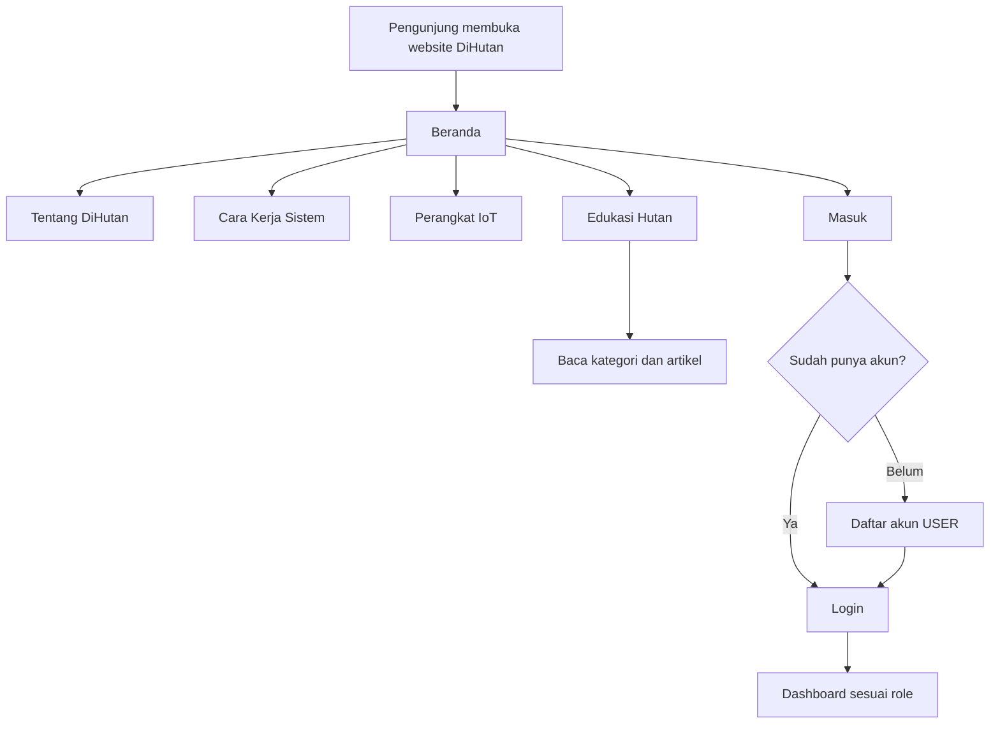
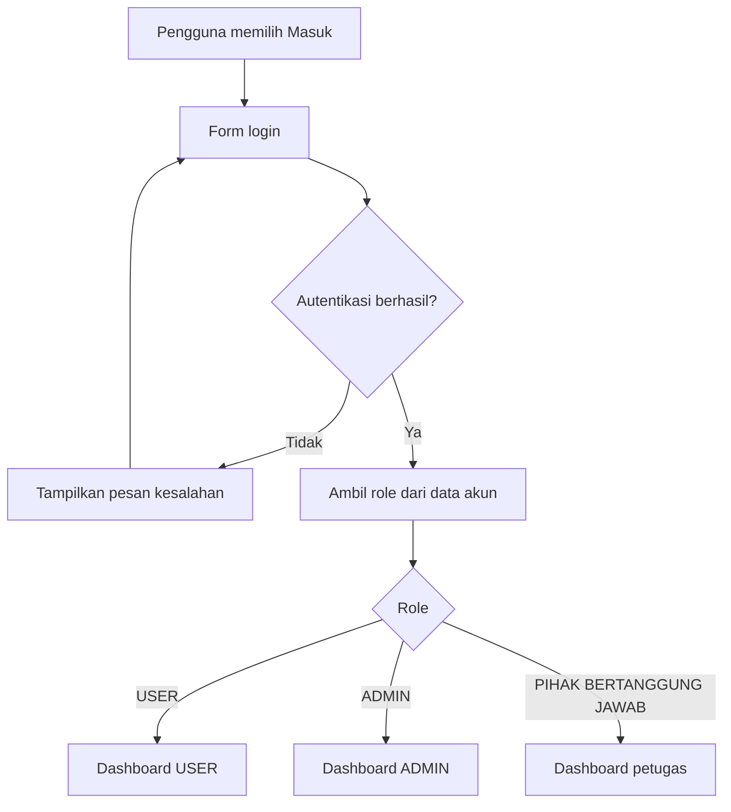
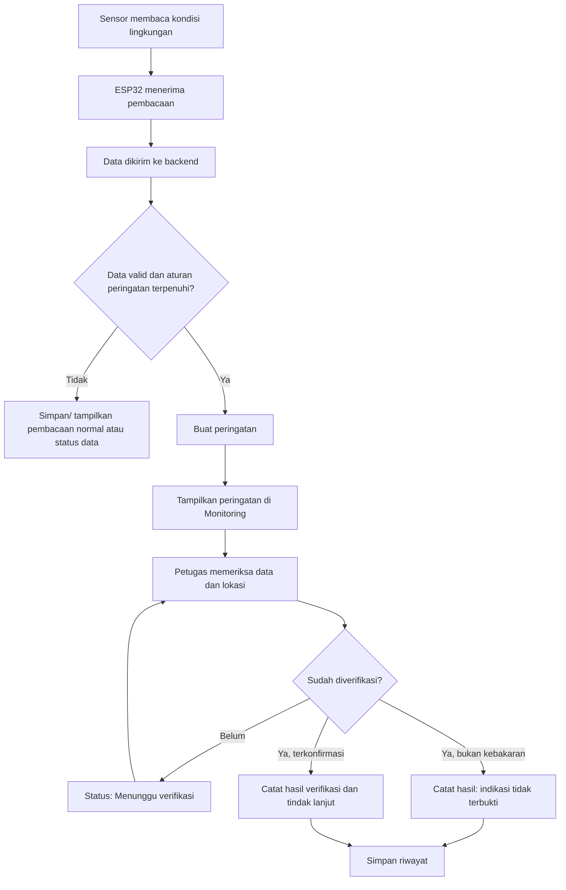
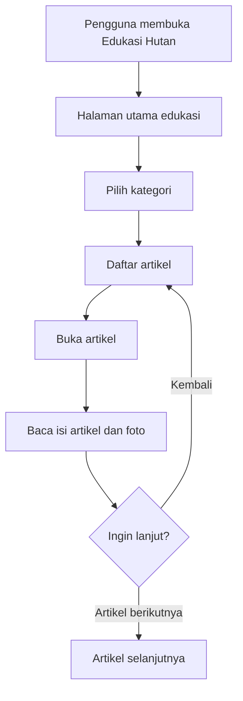

USER FLOW --- DiHutan
Dokumen alur pengguna dan struktur pengalaman website
Proyek: DiHutan --- Platform Informasi, Edukasi, dan Pemantauan
Pencegahan Kebakaran Hutan
Wilayah fokus: Hutan Kalimantan, khususnya kawasan Sungai Kapuas,
Kalimantan Barat
Status dokumen: Acuan desain dan pengembangan website
1. Tujuan Website
DiHutan bukan sekadar dashboard yang menampilkan angka sensor. Website
harus menjelaskan secara runtut:
1. Apa itu DiHutan dan masalah apa yang ingin dibantu.
2. Bagaimana proses pemantauan kondisi lingkungan dilakukan.
3. Bagaimana alur sistem ketika terdeteksi indikasi kebakaran.
4. Apa fungsi setiap perangkat IoT dan bagaimana perangkat saling
   terhubung.
5. Bagaimana pengguna membaca informasi hutan Kalimantan.
6. Bagaimana laporan, peringatan, dan tindak lanjut dikelola.
Setelah login, pengguna harus memahami konteks sistem melalui dashboard
yang informatif. Jangan langsung menampilkan kumpulan kartu angka tanpa
penjelasan.
2. Prinsip Pengalaman dan Desain
- Gunakan bahasa Indonesia yang jelas, informatif, dan tidak
  berlebihan.
- Gunakan Lucide Icons atau ikon SVG konsisten. Hindari emoji
  sebagai ikon antarmuka.
- Hindari tampilan generik hasil AI: terlalu banyak kartu kecil,
  gradien dekoratif, glow, pill, dan ornamen yang tidak memiliki
  fungsi.
- Gunakan hierarki tipografi yang kuat, jarak antarelemen yang
  konsisten, warna hijau hutan sebagai aksen, latar netral, dan
  kontras yang nyaman dibaca.
- Utamakan layout editorial/informatif: judul yang jelas, paragraf
  penjelasan, diagram alur, foto perangkat, peta, grafik, dan tabel
  jika memang dibutuhkan.
- Setiap halaman harus menjawab: halaman ini untuk apa, informasi
  apa yang ditampilkan, dan tindakan apa yang bisa dilakukan
  pengguna?
- Jangan mengarang data sensor, lokasi perangkat, status perangkat,
  kejadian kebakaran, atau laporan.
- Bedakan data nyata, data simulasi, dan data kosong dengan label yang
  terlihat jelas.
- Jangan menampilkan klaim "sistem normal" jika sumber datanya tidak
  tersedia atau belum tervalidasi.
3. Peta Situs dan Navigasi
3.1 Halaman publik
- Beranda
- Tentang DiHutan
- Cara Kerja Sistem
- Perangkat IoT
- Edukasi Hutan
- Masuk
- Daftar akun (khusus role USER)
3.2 Halaman setelah login
Navigasi utama dashboard:
1. Overview
2. Monitoring
3. Perangkat IoT
4. Edukasi Hutan
5. Laporan
6. Pengaturan
Catatan: - Peta berada di dalam halaman Monitoring, bukan menu
tersendiri. - Jangan membuat menu "Kontrol Pompa" terpisah. - Informasi
kebakaran dan peringatan ditampilkan sebagai bagian dari Monitoring
dan/atau detail laporan, bukan menu yang membingungkan. - Menu dan
tindakan khusus ditampilkan sesuai role, tetapi otorisasi tetap wajib
diperiksa di backend dan Supabase RLS.
4. Alur Pengunjung Publik

4.1 Beranda
Beranda harus memperkenalkan DiHutan secara ringkas tetapi bermakna.

Urutan konten yang disarankan:
1. Hero: nama DiHutan, satu kalimat penjelasan manfaat, dan tombol
   "Pelajari Cara Kerja" serta "Masuk".
2. Masalah: gambaran ancaman kebakaran hutan dan pentingnya
   pemantauan kondisi lingkungan. Hindari angka statistik tanpa sumber.
3. Solusi DiHutan: jelaskan hubungan pemantauan sensor, pengolahan
   data, pemberian peringatan, dan tindak lanjut.
4. Alur kerja singkat: tampilkan diagram dari sensor membaca
   lingkungan sampai informasi diterima petugas/pengguna.
5. Perangkat yang digunakan: cuplikan foto perangkat dan fungsi
   singkatnya.
6. Wilayah fokus: jelaskan fokus kawasan hutan Kalimantan dan
   Sungai Kapuas. Peta publik hanya boleh menampilkan lokasi yang
   memang tersedia dan boleh dipublikasikan.
7. Edukasi: tampilkan beberapa artikel pilihan tentang flora,
   fauna, gambut, sungai, dan konservasi.
8. Penutup: ajakan untuk masuk, membaca edukasi, atau memahami
   sistem.
Jangan membuat hero hanya berupa gambar hutan dan slogan. Pengunjung
harus mengerti DiHutan dalam beberapa detik.
4.2 Tentang DiHutan
Menjelaskan: - Latar belakang dan tujuan DiHutan. - Permasalahan yang
ingin dibantu. - Sasaran pengguna. - Ruang lingkup sistem. - Batasan
sistem: sensor memberi indikasi kondisi lingkungan, bukan otomatis
memastikan terjadinya kebakaran.
4.3 Cara Kerja Sistem
Jelaskan proses secara visual dan berurutan:
1. Sensor membaca kondisi lingkungan di sekitar perangkat.
2. ESP32 mengumpulkan nilai pembacaan sensor.
3. Data dikirim ke backend/database ketika koneksi tersedia.
4. Sistem memeriksa nilai terhadap ambang batas atau aturan yang telah
   ditetapkan.
5. Jika ditemukan kondisi yang memenuhi aturan peringatan, sistem
   membuat status/peringatan.
6. Informasi ditampilkan pada halaman Monitoring.
7. Petugas/pihak bertanggung jawab memeriksa informasi dan melakukan
   verifikasi lapangan sesuai prosedur.
8. Tindakan dan hasil pemeriksaan dicatat sebagai tindak
   lanjut/laporan.
Penting: Jangan menulis bahwa AI memprediksi kebakaran, sistem
otomatis menghubungi pemadam, atau pompa otomatis aktif jika fitur
tersebut belum benar-benar diimplementasikan dan diuji. Jelaskan hanya
kemampuan yang tersedia. Jika ada fitur yang masih rencana, beri label
"Rencana pengembangan".
5. Alur Login dan Role

5.1 USER
Dapat: - Melihat overview dan penjelasan sistem. - Melihat monitoring
yang memang diizinkan untuk publik/pengguna. - Melihat status perangkat
dan data yang diizinkan. - Membaca edukasi hutan. - Mengirim laporan
jika fitur pelaporan tersedia. - Melihat riwayat laporan miliknya. -
Mengubah pengaturan akun.
5.2 ADMIN
Dapat: - Mengelola akun dan role sesuai kewenangan. - Mengelola konten
edukasi, kategori, gambar, dan publikasi artikel. - Melihat dan
mengelola laporan. - Mengelola data perangkat, konfigurasi, dan
lokasi. - Mengelola aturan peringatan jika memang disediakan. - Melihat
riwayat aktivitas administrasi.
5.3 PIHAK BERTANGGUNG JAWAB
Dapat: - Memantau lokasi dan data perangkat yang menjadi tanggung
jawabnya. - Melihat peringatan dan laporan yang ditugaskan. -
Memverifikasi indikasi di lapangan. - Memperbarui status tindak
lanjut. - Mengelola titik/lokasi pemantauan sesuai izin. -
Mengoperasikan perangkat/aktuator hanya jika fitur kontrol benar-benar
tersedia dan diizinkan.

Pendaftaran publik hanya membuat akun USER. Akun ADMIN dan PIHAK
BERTANGGUNG JAWAB dibuat atau ditetapkan melalui proses aman oleh pihak
berwenang, bukan melalui pilihan role pada form daftar.
6. Alur Setelah Login --- Overview
Overview adalah halaman pengenalan dan ringkasan sistem, bukan hanya
halaman angka sensor.

Urutan konten:
1. Header halaman: "Overview DiHutan" dan penjelasan singkat fungsi
   dashboard.
2. Ringkasan DiHutan: paragraf singkat tentang pemantauan hutan
   Kalimantan melalui perangkat IoT dan penyajian informasi.
3. Bagaimana sistem bekerja: diagram ringkas Sensor → ESP32 →
   Backend → Monitoring/Peringatan → Verifikasi/Tindak lanjut.
4. Status pemantauan: jumlah lokasi/perangkat yang benar-benar
   terdaftar, status koneksi, dan waktu pembaruan. Jangan mengisi angka
   contoh seolah-olah nyata.
5. Ringkasan kondisi lingkungan: suhu, kelembapan udara, gas, dan
   kelembapan tanah jika data tersedia.
6. Peringatan terbaru: daftar peringatan aktual atau empty state
   jika belum ada.
7. Lokasi pemantauan: cuplikan peta atau tautan menuju Monitoring.
8. Perangkat IoT: ringkasan perangkat yang terdaftar dan tautan
   menuju penjelasan perangkat.
9. Edukasi terbaru: artikel pilihan untuk dibaca.
Setiap ringkasan harus memiliki tautan menuju halaman detail yang
relevan. Overview tidak boleh mengulang semua isi halaman Monitoring.
7. Alur Monitoring dan Penanganan Indikasi Kebakaran
Monitoring adalah pusat pemantauan kondisi lingkungan. Peta pemantauan
menjadi bagian dari halaman ini.
7.1 Struktur halaman Monitoring
1. Judul dan deskripsi tujuan halaman.
2. Status koneksi sistem dan waktu data terakhir diterima.
3. Peta kawasan Sungai Kapuas, Kalimantan Barat.
4. Penanda lokasi perangkat yang koordinatnya tersimpan di database.
5. Filter lokasi/perangkat/status.
6. Panel detail lokasi ketika marker dipilih.
7. Pembacaan sensor terkini.
8. Grafik riwayat pembacaan.
9. Daftar peringatan dan status tindak lanjut.
Peta harus dapat digeser dan diperbesar/diperkecil. Gunakan MapLibre GL
JS dengan sumber peta yang sesuai, misalnya tile OpenStreetMap untuk
tahap awal, lengkap dengan atribusi. Jangan membuat koordinat marker
perangkat sendiri. Jika koordinat belum tersedia, tampilkan empty state
atau marker DEMO yang diberi label DEMO secara jelas.
7.2 Alur ketika ada indikasi kebakaran

7.3 Status peringatan
Gunakan status yang maknanya jelas, misalnya: - Baru: peringatan
baru dibuat. - Menunggu verifikasi: belum diperiksa petugas. -
Dalam penanganan: sedang ditindaklanjuti. - Selesai: tindak
lanjut telah dicatat. - Tidak terkonfirmasi: hasil pemeriksaan tidak
membuktikan kejadian.

Status di atas adalah rancangan alur. Sesuaikan dengan fitur yang
benar-benar tersedia.
7.4 Informasi yang harus ditampilkan pada detail peringatan
- Waktu peringatan.
- Nama lokasi/perangkat.
- Koordinat jika tersedia.
- Nilai sensor yang menjadi dasar peringatan.
- Aturan/ambang batas yang terpicu.
- Status verifikasi.
- Petugas penanggung jawab jika ada.
- Catatan dan waktu tindak lanjut.
Batas penting: pembacaan sensor yang melewati ambang batas adalah
indikasi yang perlu diperiksa, bukan bukti pasti bahwa kebakaran sedang
terjadi. Jangan menyatakan sistem dapat mendeteksi api secara pasti jika
perangkat tidak memiliki sensor/validasi untuk itu.
8. Alur Perangkat IoT
Halaman Perangkat IoT harus menjelaskan perangkat yang digunakan, bukan
hanya menampilkan nama dan status.
8.1 Daftar perangkat
Gunakan foto perangkat asli yang sudah disediakan pemilik proyek di
folder aset/repository. Jangan mengganti foto tersebut dengan ilustrasi
AI, emoji, atau ikon generik. Periksa isi folder aset terlebih dahulu,
lalu cocokkan gambar dengan perangkat yang benar. Jangan mengarang nama
file; gunakan path yang benar-benar ditemukan.

Perangkat yang perlu dijelaskan sesuai perangkat proyek: 1. ESP32 ---
unit mikrokontroler yang membaca sensor dan mengirim data. 2. Expansion
Board ESP32 --- papan ekspansi untuk memudahkan koneksi pin dan suplai
daya. 3. DHT11 --- sensor suhu dan kelembapan udara. 4. Sensor gas
(MQ-series sesuai komponen yang benar-benar digunakan) --- membaca
perubahan/kadar gas sesuai karakteristik sensor. 5. Soil Moisture Sensor
--- membaca kondisi kelembapan tanah. 6. Relay 5V --- sakelar elektronik
untuk mengendalikan beban seperti pompa. 7. Mini Water Pump --- pompa
air yang digunakan pada rangkaian prototipe. 8. Adaptor --- sumber daya
listrik untuk rangkaian sesuai spesifikasi.
8.2 Format detail setiap perangkat
Setiap perangkat memiliki: - Foto asli yang jelas. - Nama perangkat. -
Fungsi dalam sistem DiHutan. - Cara kerja secara sederhana. - Hubungan
dengan perangkat lain. - Data/status yang dapat dibaca sistem. - Batas
kemampuan atau hal yang tidak dapat diukur. - Status koneksi/operasional
hanya jika memang dapat diketahui.

Jangan menampilkan status "aktif/offline" secara asal untuk semua
komponen: - Online/offline menjelaskan koneksi ESP32/perangkat ke
backend. - Aktif/nonaktif menjelaskan keadaan aktuator seperti relay
atau pompa, jika statusnya memang dikirim dan dapat diverifikasi. -
Sensor dapat memiliki status data seperti normal, tidak ada data, atau
gangguan pembacaan jika sistem mendukungnya. - Adaptor dan expansion
board bersifat pasif; jangan beri status aktif/nonaktif jika tidak ada
mekanisme untuk mengukurnya.
8.3 Diagram hubungan perangkat
Tampilkan diagram yang mudah dipahami, misalnya:
DHT11 ───────────┐
Sensor Gas ─────┤
Soil Moisture ──┤
                ▼
              ESP32
                │
                ▼
          Wi-Fi / Backend
                │
                ▼
       Database dan Monitoring

ESP32 ──> Relay 5V ──> Mini Water Pump
Diagram harus disesuaikan dengan wiring dan program perangkat yang
benar-benar digunakan. Jangan menganggap semua jalur koneksi di atas
sudah terpasang jika belum diverifikasi.
9. Alur Edukasi Hutan
Edukasi Hutan adalah perpustakaan digital/ensiklopedia, bukan game.
9.1 Alur membaca

9.2 Kategori konten
- Flora: pohon ulin, meranti, tengkawang, rotan, anggrek hutan,
  kantong semar, dan tumbuhan lain yang relevan.
- Fauna: orangutan Kalimantan, bekantan, beruang madu,
  enggang/rangkong, owa, kucing kuwuk/jenis kucing liar Kalimantan,
  dan satwa lain yang relevan.
- Tanah gambut: proses terbentuk, karakteristik, fungsi penyimpanan
  karbon dan air, ancaman kekeringan/kebakaran, serta restorasi.
- Sungai Kapuas: karakteristik sungai, ekosistem tepian sungai,
  hubungan masyarakat dengan sungai, serta ancaman lingkungan.
- Ekosistem hutan: hutan rawa gambut, hutan dataran rendah, hutan
  riparian, dan tipe ekosistem relevan.
- Kebakaran hutan: penyebab, dampak, faktor risiko, pencegahan, dan
  pemulihan.
- Konservasi: perlindungan habitat, restorasi, dan peran masyarakat.
- Teknologi pemantauan: sensor, ESP32, IoT, pengiriman data, dan
  batasan sistem.
9.3 Struktur halaman artikel
- Judul artikel.
- Kategori.
- Foto utama dan keterangan foto.
- Ringkasan artikel.
- Daftar isi untuk artikel panjang.
- Isi dengan subjudul yang terstruktur.
- Foto pendukung dengan caption dan sumber.
- Referensi/sumber bacaan.
- Artikel terkait.
- Navigasi artikel sebelumnya/berikutnya.
Gunakan tipografi nyaman dibaca dan lebar kolom teks yang tidak terlalu
panjang. Fitur bookmark atau progres baca boleh ditambahkan jika
berguna, tetapi jangan menggunakan XP, poin, level, misi, leaderboard,
kuis, atau elemen gameplay.

Konten ilmiah harus memiliki sumber yang dapat diperiksa. Jangan membuat
fakta, status konservasi, angka, atau lokasi persebaran tanpa rujukan.
10. Alur Laporan
1. Pengguna membuka halaman Laporan.
2. Pengguna membaca petunjuk dan memilih buat laporan jika fitur ini
   tersedia.
3. Pengguna mengisi informasi yang dibutuhkan: kategori, lokasi, waktu
   kejadian, deskripsi, dan foto pendukung bila tersedia.
4. Sistem memvalidasi input.
5. Laporan tersimpan dengan status awal.
6. Admin/petugas memeriksa laporan.
7. Petugas memperbarui status dan menambahkan catatan tindak lanjut.
8. Pelapor dapat melihat perkembangan laporan miliknya.
Jangan mengklaim laporan otomatis dikirim ke instansi eksternal jika
integrasi tersebut belum tersedia.
11. Alur Pengaturan
- Profil dan informasi akun.
- Ubah kata sandi melalui mekanisme autentikasi yang aman.
- Preferensi notifikasi jika tersedia.
- Informasi aplikasi dan kebijakan privasi.
- Keluar dari akun.
Menu administrasi tambahan hanya muncul untuk role yang berwenang.
12. Arah Visual dan Komponen UI
12.1 Karakter visual
Arah visual yang diinginkan adalah editorial environmental
technology: perpaduan platform pemantauan profesional dengan
ensiklopedia alam. Bukan dashboard template AI yang penuh kartu.

Gunakan: - Warna hijau hutan gelap untuk navigasi/aksen utama. - Latar
putih gading atau abu kehijauan yang sangat muda. - Teks utama berwarna
gelap dengan kontras tinggi. - Warna status hanya untuk menyampaikan
makna (hijau, kuning, merah, abu-abu). - Foto hutan dan foto perangkat
asli sebagai elemen visual utama. - Ikon outline konsisten dari
Lucide. - Grafik sederhana dengan label, satuan, dan rentang waktu. -
Border tipis dan bayangan yang sangat halus bila diperlukan.

Hindari: - Emoji. - Gradien berlebihan dan efek neon/glow. - Terlalu
banyak kartu kecil dengan bentuk sama. - Setiap informasi dijadikan
badge/pill. - Angka besar tanpa konteks. - Dekorasi yang mengalahkan
isi. - Foto stok/ilustrasi AI ketika foto asli proyek sudah tersedia. -
Animasi berlebihan; gunakan transisi singkat hanya untuk membantu
navigasi.
12.2 Komponen yang perlu konsisten
- Sidebar dan topbar.
- Breadcrumb.
- Page title dan deskripsi.
- Status badge dengan label teks.
- Data reading dengan satuan.
- Grafik sensor.
- Peta dan marker.
- Tabel laporan/peringatan.
- Kartu artikel editorial.
- Galeri/foto perangkat.
- Empty state, loading state, dan error state.
Setiap halaman harus responsif untuk desktop, tablet, dan ponsel.
13. Data, Integrasi, dan Kejujuran Status
- Website dan aplikasi Android DiHutan menggunakan backend Supabase
  yang sama.
- Gunakan Supabase Auth untuk autentikasi, PostgreSQL untuk data,
  Storage untuk gambar/file, dan Realtime jika memang diperlukan.
- Audit tabel dan struktur database yang sudah ada sebelum membuat
  perubahan.
- Reuse tabel yang sesuai; jangan membuat tabel duplikat.
- Jangan menghapus data/tabel atau menjalankan migrasi destruktif
  tanpa persetujuan eksplisit.
- Terapkan Row Level Security (RLS) dan pemeriksaan role di server.
- Kunci rahasia/service role tidak boleh berada di kode frontend.
- Data monitoring harus memiliki timestamp, sumber perangkat, dan
  satuan yang jelas.
- Tampilkan waktu data terakhir diterima; bedakan data terbaru, data
  terlambat, dan data tidak tersedia.
- Foto artikel dan foto perangkat disimpan/dirujuk dari aset proyek
  atau Supabase Storage sesuai struktur yang dipilih.
- Jangan mengubah nama atau memindahkan aset gambar milik pengguna
  tanpa memastikan referensi kodenya diperbarui.
13.1 Label sumber data
Gunakan label yang tegas: - Data perangkat: data yang benar-benar
dikirim perangkat. - Data simulasi: data buatan untuk
demonstrasi/pengembangan. - Belum tersedia: belum ada data atau
integrasi. - Koneksi terputus: perangkat tidak mengirim data dalam
batas waktu yang ditentukan.

Jangan mencampur data simulasi dan data perangkat dalam satu grafik
tanpa penanda yang jelas.
14. Kriteria Penerimaan (Acceptance Criteria)
Website dianggap mengikuti user flow ini apabila:
- [ ] Pengunjung dapat memahami tujuan DiHutan dari halaman publik.
- [ ] Cara kerja sistem dijelaskan dari sensor sampai
  verifikasi/tindak lanjut.
- [ ] Setelah login, Overview menjelaskan konteks sistem dan memberi
  jalur ke fitur utama.
- [ ] Monitoring memuat peta di halaman yang sama, bukan menu peta
  terpisah.
- [ ] Peta berfokus pada kawasan Sungai Kapuas dan tidak mengarang
  lokasi perangkat.
- [ ] Detail lokasi menampilkan data sensor, waktu pembaruan, dan
  status data.
- [ ] Alur peringatan membedakan indikasi sensor dengan kejadian
  kebakaran yang telah diverifikasi.
- [ ] Halaman Perangkat IoT menjelaskan fungsi dan hubungan setiap
  komponen.
- [ ] Foto perangkat menggunakan aset asli dari folder proyek yang
  disediakan pengguna.
- [ ] Status online/offline dibedakan dari status aktif/nonaktif
  aktuator.
- [ ] Edukasi berbentuk artikel/ensiklopedia, bukan game atau kuis.
- [ ] Artikel memiliki kategori, gambar, struktur bacaan, dan sumber.
- [ ] Laporan memiliki status dan riwayat tindak lanjut jika fitur
  pelaporan diaktifkan.
- [ ] Role USER, ADMIN, dan PIHAK BERTANGGUNG JAWAB memiliki batas
  akses yang benar.
- [ ] Pendaftaran publik hanya menghasilkan role USER.
- [ ] Tidak ada data, lokasi, status, atau klaim kemampuan sistem yang
  dibuat-buat.
- [ ] UI menggunakan ikon, bukan emoji, dan tidak terasa seperti
  template dashboard generik.
- [ ] Tampilan tetap nyaman digunakan pada desktop dan perangkat
  mobile.
15. Catatan untuk Pengembang
Dokumen ini menjadi acuan alur dan pengalaman pengguna. Sebelum
mengimplementasikan fitur:
1. Periksa struktur repository dan aplikasi yang sudah ada.
2. Periksa folder aset untuk menemukan foto perangkat dan foto hutan
   yang disediakan pengguna.
3. Periksa database Supabase yang sudah terhubung.
4. Petakan fitur yang sudah berjalan, belum berjalan, dan masih berupa
   rencana.
5. Pertahankan fitur yang sudah berfungsi dan kompatibilitas dengan
   aplikasi Android.
6. Jika ada kebutuhan yang belum didukung data/backend/hardware, buat
   empty state atau tandai sebagai belum tersedia. Jangan membuat data
   palsu agar UI terlihat penuh.
7. Implementasikan secara bertahap dan uji alur setiap role dari login
   sampai fitur yang diizinkan.